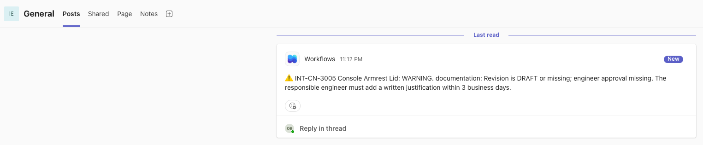
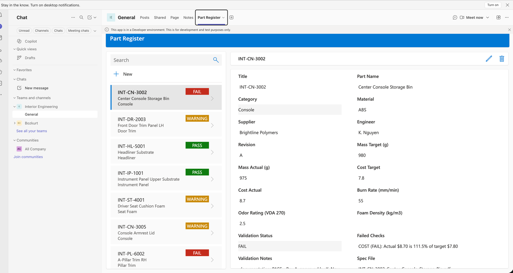
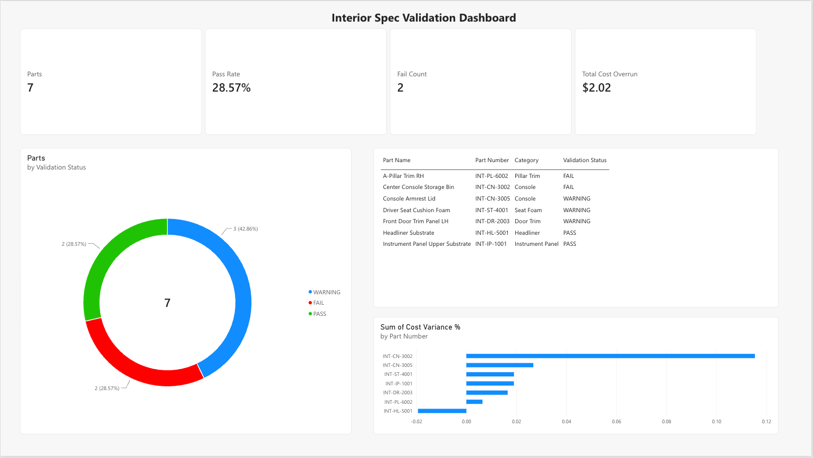
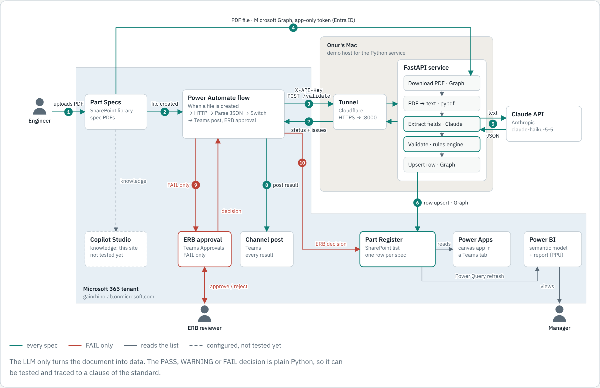
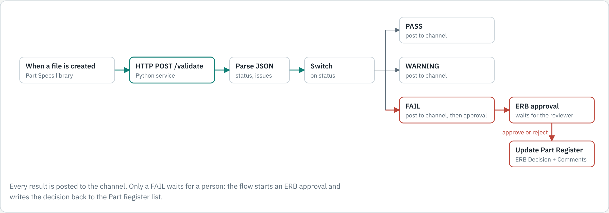
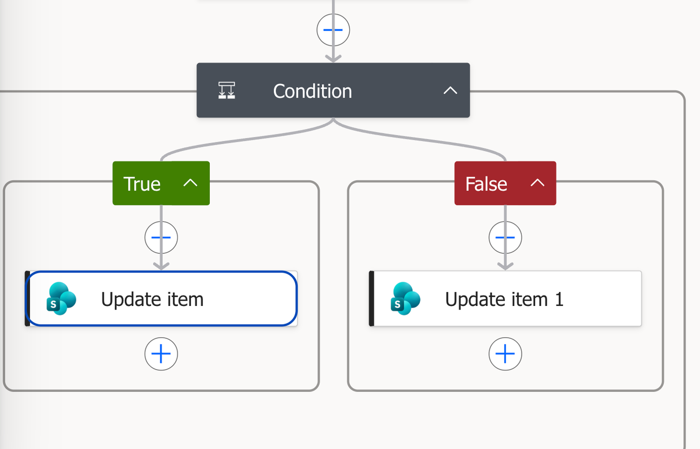

# Spec Checker

**AI-assisted validation of engineering specifications on Microsoft 365.**

An engineer uploads a component specification PDF to SharePoint. Spec Checker extracts the design data with an LLM,
validates it against the company design standard with deterministic rules, records the result in a SharePoint list,
notifies the team in Microsoft Teams, and routes failures to an Engineering Review Board approval. Engineers browse
results in a Power Apps app inside Teams; managers track pass rate and cost overrun in Power BI.

> **Portfolio project.** "Corvane Motors", its suppliers, parts and the CM-IDS-001 standard are fictional sample data.

| | |
|---|---|
| **Extraction + validation accuracy** | 10 / 10 on a labelled test set (3 document layouts, mixed units) |
| **Automated tests** | 37 (rule boundaries, API, extractor) |
| **Human steps per spec** | 1 upload; approval only when a spec fails |

---

## Demo



| Power Apps in a Teams tab | Power BI dashboard |
|---|---|
|  |  |

Video walkthrough: _link coming soon_

Live demo: available on request over screen share. The Microsoft 365 side runs in a private developer tenant, so there is no public URL.

---

## Architecture



| Step | Component | What happens |
|---|---|---|
| 1 | SharePoint | Engineer uploads a spec PDF to the `Part Specs` library |
| 2 | Power Automate | Trigger fires and calls the API with the file name (shared-secret header) |
| 3 | Python / Microsoft Graph | Service downloads the PDF using app-only auth (MSAL client credentials) |
| 4 | Claude | Converts the document text into typed JSON via forced tool use (units normalised, no guessing) |
| 5 | Rules engine | Checks material, mass, cost, flammability, odor, foam density and documentation against CM-IDS-001 |
| 6 | Microsoft Graph | Upserts one row per spec in the `Part Register` list |
| 7 | Power Automate | Switch on status: Teams post for PASS / WARNING; Teams post plus ERB approval for FAIL; writes the decision back to the list |
| 8 | Power Apps, Power BI | Engineers browse and filter results in Teams; dashboard shows pass rate, fail count and cost overrun |





---

## Design decisions

**LLM extracts, code decides.** The model only turns a document into structured data. Every PASS / WARNING / FAIL
decision is made by plain Python in [`spec_checker/rules.py`](spec_checker/rules.py), so results are deterministic,
unit-tested and traceable to a clause of the standard. Swapping the model does not change the rules.

**Measured, not assumed.** [`scripts/eval_local.py`](scripts/eval_local.py) runs extraction and validation end to end on
labelled sample specs and reports accuracy. The set is small (10 documents) but deliberately varied: table, narrative
and form layouts, and mass given in grams or kilograms.

**Say "not found" instead of guessing.** The extraction prompt requires `null` for missing values, and missing values
become WARNING results rather than silent passes.

**Idempotent writes.** Re-validating a file updates its existing row (matched on the drive item id) instead of creating
duplicates. List provisioning is also idempotent: re-running `provision.py` only adds missing columns.

**Security.**
App-only Graph access with a client secret kept in `.env` (never committed); the API requires an `X-API-Key` header.
Next hardening step: replace `Sites.ReadWrite.All` with `Sites.Selected` so the app can only reach this one site.

**Lesson learned (DAX filter context).** The first `Pass Rate` measure used
`CALCULATE(COUNTROWS(...), Status = "PASS")`, which overrides an outer FAIL filter and showed 100% when the FAIL
slice was selected. Wrapping the condition in `KEEPFILTERS` fixed it.

---

## Validation rules (CM-IDS-001 Rev C)

| Check | PASS | WARNING | FAIL |
|---|---|---|---|
| Material | Approved for the category | Category or material missing | Not on the approved list |
| Mass (actual / target) | ≤ 105% | ≤ 110% | > 110% |
| Piece cost (actual / target) | ≤ 103% | ≤ 108% | > 108% |
| Flammability, FMVSS 302 burn rate | ≤ 80 mm/min | ≤ 102 mm/min | > 102 mm/min |
| Odor, VDA 270 | ≤ 3.0 | 3.5 | ≥ 4.0 |
| Seat foam density | 45 to 60 kg/m3 | missing | outside range |
| Documentation | Revision letter and engineer approval | DRAFT or no approval | |

Overall result = most severe individual result.

---

## Repository layout

```
spec_checker/
  config.py      settings from .env
  graph.py       Microsoft Graph client (MSAL auth, retries on 429, paging)
  schema.py      Part Register list schema, defined as code
  extract.py     Claude extraction with a JSON schema tool
  rules.py       CM-IDS-001 rules engine
  register.py    list field mapping and upsert
  pipeline.py    download, extract, validate, write
  api.py         FastAPI endpoint called by Power Automate
scripts/         provision, smoke_test, validate, eval_local
tests/           pytest suite
tools/           sample data generator
sample_data/     fictional spec PDFs, standard, answer key
docs/images/     screenshots
```

## Running it

```bash
python3 -m venv .venv
source .venv/bin/activate
pip install -r requirements.txt
cp .env.example .env
python -m pytest -q
python -m scripts.eval_local --pdf-dir sample_data/specs --answer-key sample_data/answer_key.csv
python -m scripts.smoke_test
python -m scripts.provision
python -m scripts.validate
python -m uvicorn spec_checker.api:app --port 8000 --env-file .env
```

`.env` needs the Entra ID app (tenant id, client id, secret), the SharePoint site, a Claude API key and the shared API
key. The Entra app needs the Microsoft Graph application permissions `Sites.ReadWrite.All` and `Sites.Manage.All`
with admin consent.

Microsoft 365 side: a SharePoint team site with `Part Specs` and `Standards` libraries, a Teams team on the same group,
the Power Automate flow (packaged in the `Spec Checker` solution), a Power Apps canvas app on the `Part Register` list,
and a Power BI semantic model and report on the same list.

---

## Limitations and next steps

- **Hosting.** The API runs locally behind a Cloudflare quick tunnel for the demo; production would use Azure Functions
  or Container Apps with a managed identity and Key Vault.
- **Copilot Studio.** A knowledge agent grounded on the SharePoint site is configured. Testing is pending: since 2026,
  Copilot Studio test chats consume credits, and developer environments cannot be linked to a pay-as-you-go billing
  plan, so a sandbox environment with a billing plan is needed.
- **Evaluation set.** Grow the labelled set, add scanned PDFs (OCR) and adversarial cases.
- **Least privilege.** Move to `Sites.Selected`.
- **Power BI.** Sensitivity labels and row-level security per division.

## Tech stack

Python 3 · FastAPI · MSAL · Microsoft Graph · Claude (Anthropic API) · pypdf · pytest ·
SharePoint Online · Power Automate · Approvals · Microsoft Teams · Power Apps · Power BI (DAX, Power Query) ·
Copilot Studio · Microsoft Entra ID
